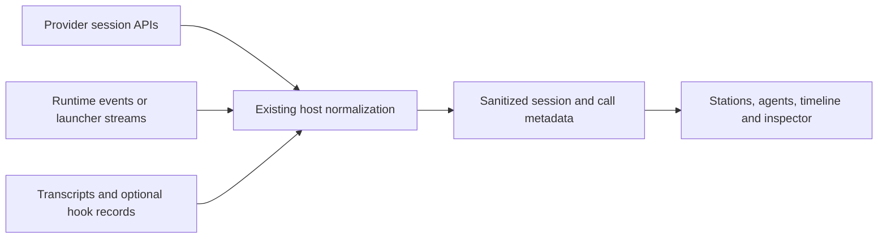

# Provider SDKs and event interfaces for AgentViz

14 November 2026. Architecture research for the existing VS Code extension. Recommendation only; no runtime integration, provider configuration change, SDK installation or agent launch was performed.

**Recommendation: use official provider interfaces selectively, behind the existing event normalization boundary. Keep transcript reading for historical evidence, unsupported sessions and fallback. Do not rebuild AgentViz as an SDK agent launcher merely to obtain visualization data.**

The strongest first experiment is a Codex App Server adapter. Claude's session utilities are also worth evaluating for discovery and history. For agents launched by AgentBoard, forwarding the launcher's structured stream may be simpler than adding an SDK dependency to AgentViz.

## What an SDK would change

There are three distinct products commonly called an SDK:

| Interface | What it provides | Fit for AgentViz |
| --- | --- | --- |
| Model API client | Sends inference requests and receives model responses and tool requests | Useful when building an agent; does not by itself expose an independently running coding agent's filesystem activity, execution results or sessions |
| Coding agent SDK | Runs or resumes a provider's agent runtime and streams its events | Strong fit if another application already owns the agent run and forwards events; adopting it as the only source can require changing how agents are launched |
| Session and runtime interface | Reads provider-managed history or connects to the runtime serving a session | Best match for an observer, subject to transport access, history completeness and side-effect checks |

Official SDK event streams are usually easier to interpret than undocumented transcript records. That does not establish that every SDK can attach to every running CLI or IDE session, preserve every historical event, or reveal operations hidden inside another tool. Runtime ownership and observation access must be tested separately.

## Provider findings

### OpenAI Codex

**Use App Server for the observation experiment. The TypeScript automation SDK is a different integration surface.** OpenAI distinguishes task automation through the SDK from custom clients using App Server for history, approvals and streamed events. The TypeScript SDK wraps a CLI process and offers `runStreamed()` for work that the application runs. OpenAI also publishes an official Python SDK over App Server; AgentViz's JavaScript host does not need a Python bridge just to use the protocol. [Official SDK guide](https://learn.chatgpt.com/docs/codex-sdk), [TypeScript SDK source README](https://github.com/openai/codex/blob/main/sdk/typescript/README.md).

App Server offers structured command execution, file changes, MCP calls, agent collaboration, turn lifecycle, errors and token updates. Commands can carry explicit status, exit code and duration; file changes carry their own status and change records. This is a promising basis for a command waterfall, correlated request/result signals and agent relationships. It still requires normalization: an accepted tool call, a completed tool call and a completed background process are different facts. [App Server reference](https://learn.chatgpt.com/docs/app-server).

History reads can use `thread/read`, `thread/turns/list` and `thread/items/list` without resuming the thread. `thread/read` does not subscribe to its events. A resumed thread participates in runtime lifecycle, and subscriptions affect how long threads remain loaded. Therefore, do not use resume as an assumed harmless substitute for a read-only live subscription. Listing can also scan logs to repair metadata by default; the documented `useStateDbOnly` option avoids that repair path when its coverage is sufficient. [Thread and history reference](https://learn.chatgpt.com/docs/app-server#threads).

The installed Codex CLI reports version `0.167.2`. Its local help exposes `app-server proxy` for connecting stdio to a running control socket, plus daemon management and schema generation commands. This makes an existing-runtime connection a concrete candidate on this machine. Help output alone does not prove that the active CLI, desktop and IDE sessions all share that runtime, or that connecting provides the required event access. A newly spawned independent server must not be assumed to observe another server's live work. The documented protocol supports stdio and local socket connections; TCP WebSocket support is marked experimental and unsupported. [Official transport documentation](https://learn.chatgpt.com/docs/app-server#protocol), [developer commands](https://learn.chatgpt.com/docs/developer-commands#codex-app-server).

**Decision:** test existing-runtime history access first, then live observation in an isolated two-client session. Keep the transcript adapter until session coverage, lifecycle effects and reconnect behavior are demonstrated.

### Anthropic Claude Code

**The Agent SDK now has useful observer-facing utilities.** `listSessions()` discovers saved sessions, including worktree-aware lookup. `getSessionMessages()` reads their messages. The SDK documentation also describes subagent history utilities and parent tool/agent identities. These could replace parts of AgentViz's custom discovery and family lookup. They are distinct from invoking `query()` or resuming an agent to run a prompt. [Session guide](https://code.claude.com/docs/en/agent-sdk/sessions), [TypeScript reference](https://code.claude.com/docs/en/agent-sdk/typescript), [subagent storage behavior](https://code.claude.com/docs/en/agent-sdk/session-storage).

Two details matter for this extension:

1. The documented session `summary` may fall back to recent or initial prompt text. AgentViz currently permits saved titles but excludes prompt-derived names. Copying `summary` into the picker would weaken that boundary. Prefer appropriate saved-title metadata and preserve the unnamed fallback.
2. A conversation-history API is not necessarily a complete event ledger. In particular, the custom session-store documentation says `getSessionMessages({ sessionStore })` returns the conversation chain after compaction; accessing the store's raw entries is a separate operation. That statement is specific to the documented store path and must not be generalized to every local history call. Verify timing fields, compaction boundaries, pre-compaction events and nested-agent coverage before replacing the current reader. [TypeScript session metadata](https://code.claude.com/docs/en/agent-sdk/typescript), [session-store history semantics](https://code.claude.com/docs/en/agent-sdk/session-storage).

For live capture, Claude exposes hooks for tool starts, successes, failures, subagent lifecycle and other events. SDK hooks operate within SDK-driven execution; configured CLI hooks provide another capture route. This offers an optional live source for sessions outside an AgentViz launcher, but it requires configuration and introduces code into the agent's execution path. It should be opt-in and should preserve existing hooks. No generic passive subscription to arbitrary already-running Claude processes was established by this research. [Claude Code hook reference](https://code.claude.com/docs/en/hooks), [Agent SDK hooks](https://code.claude.com/docs/en/agent-sdk/hooks).

**Decision:** evaluate the read-only utilities before adopting the SDK as a dependency. Retain incremental transcript capture where the utilities lose necessary evidence. Consider optional hooks for missing lifecycle events rather than requiring users to launch Claude through AgentViz.

### Google Gemini CLI

**Start with the CLI's supported event output, not the model API client.** Headless Gemini CLI supports `stream-json`, with initialization, messages, tool requests/results, errors and final statistics. If AgentBoard launches Gemini, this is a straightforward candidate for event forwarding. It observes that launched run, not automatically an unrelated interactive terminal. [Headless mode reference](https://geminicli.com/docs/cli/headless/).

Google's repository also contains a Gemini CLI SDK. Its design document marks the core loop, tool execution and session context implemented while marking hooks, skills, subagents and ACP incomplete. These are design-document status statements, not a tested package compatibility guarantee. For AgentViz's intended agent-family visualization, that is a reason to verify the released package rather than assume SDK parity with the CLI. [Official SDK design document](https://github.com/google-gemini/gemini-cli/blob/main/packages/sdk/SDK_DESIGN.md).

The CLI's hook interface can capture lifecycle and tool events. Its hooks run synchronously in the agent loop, so a collector must be short and reliable; collecting visualization metadata should not delay execution unnecessarily. [Gemini CLI hooks](https://geminicli.com/docs/hooks/), [hook payload reference](https://github.com/google-gemini/gemini-cli/blob/main/docs/hooks/reference.md).

**Decision:** use structured launcher output for controlled runs; investigate hooks and retained history for independently launched sessions. Do not choose the developing CLI SDK as the common foundation for all providers.

### GitHub Copilot

**A promising future adapter with a substantial structured event model.** Copilot's SDK drives its runtime over JSON-RPC. It normally manages the runtime process but can connect to an external CLI server. It exposes session management, history and streaming events. [Official SDK repository](https://github.com/github/copilot-sdk), [CLI compatibility reference](https://docs.github.com/en/copilot/how-tos/copilot-sdk/troubleshooting/compatibility).

Its event envelope includes event identity, timestamp, optional agent identity and an ephemeral flag. Some live events are not persisted or replayed, so historical replay cannot silently reconstruct them. The envelope's `parentId` denotes the preceding event in the chain; it is not itself a delegation relationship. The documentation also notes that a terminal process may continue after the tool-completion event, reinforcing the need to track process state separately. [Streaming event reference](https://docs.github.com/en/copilot/how-tos/copilot-sdk/features/streaming-events).

An external-server option does not establish that an arbitrary Copilot IDE extension session exposes that server. SDK create/resume behavior can also involve ongoing work and callbacks; an observer needs a narrower, tested access path.

**Decision:** worth adding if Copilot becomes a requested source. Keep its event model provider-specific at ingestion, then normalize only supported facts.

### xAI Grok Build

**Use Grok Build's coding-runtime interfaces rather than its general model SDK.** The official CLI documents headless `streaming-json` output and saved sessions. The hook interface includes tool success/failure and subagent lifecycle events. This makes a launcher stream or optional hook adapter a plausible route without rebuilding the agent around a model API client. The research did not establish a universal read-only live attachment API. [Headless and scripting reference](https://docs.x.ai/build/cli/headless-scripting), [Grok Build hooks](https://docs.x.ai/build/features/hooks), [official model SDK](https://github.com/xai-org/xai-sdk-ts).

**Decision:** add a provider adapter when needed; retain the distinction between observing an existing coding runtime and creating a new agent using the model API.

## Recommended architecture

Keep provider access in the VS Code extension host. The webview continues to receive sanitized normalized data and request sensitive call details explicitly. SDK payloads should never be forwarded wholesale to the webview.

Use the existing event model and add only fields required by a demonstrated source: stable call identity, recorded start/end, outcome, recorded parent or link, and evidence provenance. Distinguish source timestamps from the time AgentViz received an event. Live and stored copies of the same event must reconcile without double counting. If a stream drops, state that gap until history has repaired it.

Adapters should disclose their capabilities. A source may support live starts/results but not historical durations, or main-agent calls but not child-agent activity. Missing data remains unavailable. SDK adoption does not make shell-internal file edits visible, establish that a later success fixed an earlier error, or expose every underlying network request.

This architecture keeps the current UI work useful. It also lets AgentBoard forward events it already receives without requiring AgentViz to own agent execution. A local append-only event file is one possible forwarding mechanism if needed; choosing a server, database or tracing service is unnecessary for the first experiment.

## Smallest useful validation

1. **Codex history:** compare official history reads with the current normalized transcript fixture for calls, statuses, identities, timing and child links. Verify pagination, omitted source kinds and missing history. Use read methods, not a prompt or resume, for this check.
2. **Codex live observation:** use an isolated runtime with an ordinary client and a second observer. Capture a long command, a failed command, an edit, a child agent, a disconnect and reconnect. Establish whether subscribing affects runtime retention, approval routing or execution. Then assess the installed shared-daemon transport separately.
3. **Claude history:** compare SDK session utilities with a fixture containing a saved title, no saved title, nested agents, compaction and timestamps. Prove no prompt text becomes a session label and determine which raw records remain necessary.
4. **Keep the change conditional:** adopt only an interface that improves fidelity or removes meaningful parser maintenance without losing required coverage. Keep a transcript fallback until that comparison passes.

No generation requests are needed for stored-history comparisons. Any controlled live experiment would perform ordinary agent work and must account for its normal usage. SDK installation itself is not a reason to start a model run.

## Evidence and limits

Research used Exa across five provider workstreams, returning 37 search-result entries before deduplication, plus direct reads of official documentation/source and OpenAI's developer-docs connector. Search results were discovery material; the recommendations above rely on the linked provider documentation and official repositories. The local checkout was rechecked at `b047fc1`; existing unrelated changes were preserved.

Local verification was limited to installed command resolution and version/help output: Codex `0.167.2`, Claude Code `2.1.325`, and Codex App Server's proxy/daemon command availability. No SDK was installed, no live session was resumed or subscribed, no daemon was started/restarted, and no provider settings or product files were changed. Cross-client attachment, overhead, event completeness and released-package parity remain unmeasured.

**Decision:** a complete SDK rewrite would trade away AgentViz's broad observer role without a demonstrated benefit. Official runtime/history adapters plus retained transcript support are the better direction. Validate Codex App Server first, then Claude's read-only session utilities.
